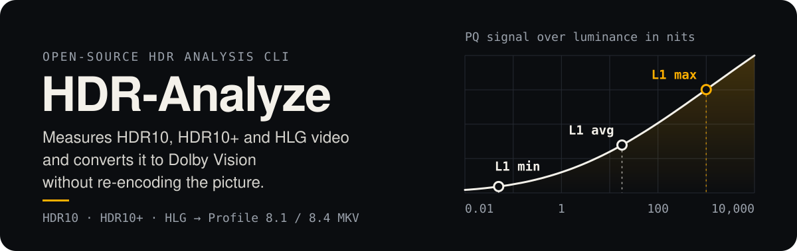
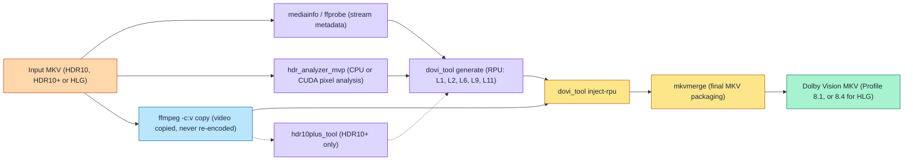

<p align="center"></p>

# HDR-Analyze

[](https://github.com/tinof/hdr-analyze/actions/workflows/ci.yml)
[](https://github.com/tinof/hdr-analyze/releases/latest)
[](https://opensource.org/licenses/MIT)
[](https://github.com/rust-lang/rust)

HDR-Analyze measures HDR10, HDR10+ and HLG video and converts it to Dolby Vision (Profile 8.1, or 8.4 for HLG) without re-encoding the picture.

HDR-Analyze is an independent project, not affiliated with or endorsed by Dolby Laboratories, and Dolby Vision is a Dolby trademark ([provenance](docs/PROVENANCE.md)). Current version: 0.9.0.

## How it works

`mkvdovi` copies the compressed HEVC video stream with `ffmpeg` without re-encoding while `mediainfo`/`ffprobe`, `hdr_analyzer_mvp` and (for HDR10+) `hdr10plus_tool` collect the stream and luminance metadata. `dovi_tool` generates the RPU and injects it into the copied stream, and `mkvmerge` packages the Dolby Vision MKV.



- `mkvdovi` never encodes video: HDR10 and HDR10+ inputs become Profile 8.1 MKVs, and HLG inputs become Profile 8.4 MKVs, with the video stream copied unchanged.
- `hdr_analyzer_mvp` measures decoded pixels directly from the compressed HEVC source without a ProRes or raw intermediate, and `mkvdovi` writes per-scene L1 plus L2, L6, L9 and L11 metadata for `dovi_tool` to generate and inject the RPU.
- `mkvdovi` also reuses existing HDR10+ metadata, audits RPUs with `mkvdovi inspect`, rebuilds metadata on existing Dolby Vision files with `--mdfix`, and runs on the CPU under Linux, macOS and Windows.

## Quick start

Install the release binaries (Linux x64, macOS Intel and Apple Silicon, Windows x64):

```bash
curl -fsSL https://github.com/tinof/hdr-analyze/releases/latest/download/install.sh | bash
```

On Windows, download the zip from the [latest release](https://github.com/tinof/hdr-analyze/releases/latest) and keep the bundled FFmpeg DLLs next to the `.exe` files. A PowerShell install script also exists, but it has not been tested on Windows yet ([details](docs/INSTALLATION.md)).

Convert a file:

```bash
mkvdovi movie.mkv --keep-source
```

> **The source file is deleted after a successful conversion** unless you pass `--keep-source`.
> Inputs that already carry Dolby Vision metadata, and all `--mdfix` runs, keep the source.

Every conversion needs `ffmpeg`, `mkvmerge`, [`dovi_tool`](https://github.com/quietvoid/dovi_tool/releases) 2.3.2 or newer, and `mediainfo` (recommended) or `ffprobe` installed separately on `PATH`; HDR10+ inputs also need [`hdr10plus_tool`](https://github.com/quietvoid/hdr10plus_tool/releases).

<details>
<summary>External tools and runtime requirements</summary>

`mkvdovi` checks for all of these on `PATH` at startup except `hdr10plus_tool`:

| Tool | Needed for |
|---|---|
| `ffmpeg` | every conversion |
| `mkvmerge` (MKVToolNix) | final MKV packaging |
| [`dovi_tool`](https://github.com/quietvoid/dovi_tool/releases) 2.3.2 or newer | RPU generation and injection (2.3.4+ reads MKV directly) |
| `mediainfo` (recommended) or `ffprobe` | stream inspection. MediaInfo supplies the L6 and L9 source values; with `ffprobe` alone they fall back to defaults. |
| `ffprobe` (ships with FFmpeg) | the check that the output keeps the source's video timestamps. Without it a conversion still runs, warns, and keeps the source. |
| [`hdr10plus_tool`](https://github.com/quietvoid/hdr10plus_tool/releases) | HDR10+ input. An HDR10+ file fails if the tool is missing. |

</details>

HDR10+ conversions also run `hdr_analyzer_mvp`, which ships with `mkvdovi`. Without a current analyzer they take L1 from the HDR10+ metadata alone, with a warning.

To build from source instead, run `cargo build --release --workspace`. For GPU analysis on an NVIDIA host, add `cargo build --release -p hdr_analyzer_mvp --features cuda` (needs only the NVIDIA driver at runtime, no CUDA toolkit). FFmpeg dev libraries, clang and per-OS notes are in [docs/INSTALLATION.md](docs/INSTALLATION.md).

## Performance and validation

Measured accuracy against synthetic references and Dolby-generated metadata, plus end-to-end CUDA throughput on an RTX 4070:

| Check | Measured result | Conditions and source |
|---|---|---|
| Synthetic patterns | Peaks within 0.25 of one 12-bit PQ code | Known-peak lossless test clips ([docs/VALIDATION.md](docs/VALIDATION.md)) |
| Reference metadata (max-RGB peaks) | 12.8 codes high on average | Asset with Dolby-generated reference metadata ([docs/VALIDATION.md](docs/VALIDATION.md)) |
| HDR10+ metadata alone (`--hdr10plus-l1 hdr10plus`) | Per-shot median error 1 code (max 17) | Compared with Dolby's v4 analyzer ([docs/VALIDATION.md](docs/VALIDATION.md)) |
| Scene detection | 13 of 14 authored cuts on Title A (24 emitted); 1 of 34 on a near-static asset | ±1 frame on Title A; base layer is nearly constant in luma on the near-static FEL test asset ([docs/VALIDATION.md](docs/VALIDATION.md)) |
| Grainy real-content assets (default `max` estimator) | +74 and +93 codes hot against reference | Open gap on two grainy assets; opt-in grain-rejecting estimator (`--peak-estimator`, see [docs/CLI_REFERENCE.md](docs/CLI_REFERENCE.md)) narrows it but does not close it ([docs/VALIDATION.md](docs/VALIDATION.md)) |
| CUDA analysis (4K HDR10 / 4K HLG) | About 325 fps / 490 fps | RTX 4070, frames ÷ wall time of whole analyzer run ([docs/PERFORMANCE.md](docs/PERFORMANCE.md)) |

Optional NVDEC decode and CUDA analysis work on decoded frames in GPU memory, with L1 output identical to earlier builds ([docs/PERFORMANCE.md](docs/PERFORMANCE.md) records the test conditions and reproduction recipe; [docs/CUDA_PIPELINE.md](docs/CUDA_PIPELINE.md) explains how the GPU path reaches these rates). The Linux x64 and Windows x64 release archives include it and need only the NVIDIA driver (R560 or newer).

CPU and GPU agreement shows the two paths are consistent. It says nothing about accuracy. The accuracy evidence is in [docs/VALIDATION.md](docs/VALIDATION.md), and the remaining gaps are in [docs/CM_ANALYZE_PARITY.md](docs/CM_ANALYZE_PARITY.md). The only playback comparison so far is the HLG composer test on an LG OLED C9 ([docs/ROADMAP_LOG.md](docs/ROADMAP_LOG.md), 2026-10-13).

## Why another HDR analyzer?

Dolby provides its own professional tools for this job. If you already use them and the workflow suits you, keep using it. HDR-Analyze exists for other situations:

- You have HDR10, HDR10+ or HLG files and want Dolby Vision output (Profile 8.1, or 8.4 for HLG) from a command-line conversion.
- Reading and changing the analysis code matters to you, down to how each metadata value is computed.
- Your source is a delivered HEVC file and you would rather not export an intermediate first.
- You have an NVIDIA GPU and want to use it for the measurement pass.
- You want published error figures, including where the output is still wrong.

## Compatibility

| Input | Output | Picture re-encoded | Maturity |
|---|---|---|---|
| HDR10 | Profile 8.1, CM v4.0 metadata | No | Measurement comparisons published; playback unvalidated |
| HDR10+ | Profile 8.1, L1 scenes from HDR10+ and the analyzer, peak from HDR10+, average and minimum measured (`--hdr10plus-l1 hdr10plus` for HDR10+ metadata alone) | No | Measurement comparisons published; playback unvalidated |
| HLG | Profile 8.4 (HLG base layer kept bit-exact), L1 measured through the 8.4 decode (luma and chroma curves); composer fitted to BT.2100 by default (`--hlg-composer preset` for the `dovi_tool` preset) | No | Decode validated against libplacebo; composer applied on an LG OLED C9 |
| Dolby Vision Profile 7 MEL | Profile 8.1 | No | Works |
| Dolby Vision Profile 7 FEL | None: the file is refused | – | Not supported ([plan](docs/FEL_PLAN.md)) |
| Profile 8.1 or MEL with `--mdfix` (Profile 8.4 is refused) | Profile 8.1 with rebuilt metadata | No | Works; not a guaranteed improvement |

Flag-level detail is in [docs/FORMAT_COMPATIBILITY.md](docs/FORMAT_COMPATIBILITY.md) and [docs/CLI_REFERENCE.md](docs/CLI_REFERENCE.md).

## Limitations

- The default peak estimator is sensitive to film grain (see above). The grain-rejecting estimator is opt-in (`--peak-estimator robust`, CPU and CUDA) and not yet accurate enough to be the default.
- Profile 7 FEL input is not supported. `mkvdovi` refuses the file and keeps it. The earlier BL+EL compositor was removed because it did not match the Dolby Vision reconstruction specification (ETSI GS CCM 001) on real discs. A design that keeps the base layer bit-exact and re-encodes nothing is planned in [docs/FEL_PLAN.md](docs/FEL_PLAN.md). `mkvdovi inspect` still reports FEL.
- Hardware decode in the analyzer is CUDA only. VAAPI and VideoToolbox requests fall back to software decode.
- There is no Profile 5 output and no XML metadata export.
- The metadata is format-compatible with CM v4.0. It is produced by this project's own measurements and does not implement Dolby's analysis algorithm.
- HLG sources become Profile 8.4. Player support for 8.4 is narrower than for 8.1 (Apple TV and LG TVs handle it; many players ignore the RPU and play the HLG base layer).
- Playback has been compared on one display only: the HLG composer test on an LG OLED C9 (2026-10-13). HDR10, HDR10+ and other devices are untested.

The HLG 1000-nit range cap, the default BT.2100 composer and the `--hlg-composer preset` option are detailed below.

<details>
<summary>HLG Profile 8.4 measurement and composer details</summary>

HLG L1 is capped at the RPU's declared source range of about 1000 nits, so the brightest HLG codes (which the default 8.4 preset curves decode above it) read at that cap; peaks are max-RGB of the full 8.4 decode (luma and chroma curves). By default the RPU carries a composer fitted to the BT.2100 HLG-to-PQ conversion ([docs/HLG_COMPOSER.md](docs/HLG_COMPOSER.md)); `--hlg-composer preset` writes the `dolby_vision` crate's preset instead, which tints neutral greys slightly blue. A playback test showed that an LG OLED C9 applies the fitted composer; other devices are untested.

</details>

## Documentation

These files ship in each release archive next to this README. They are also [online](https://github.com/tinof/hdr-analyze/tree/main/docs).

- [docs/INSTALLATION.md](docs/INSTALLATION.md): release archives, runtime tools, source and CUDA builds
- [docs/CLI_REFERENCE.md](docs/CLI_REFERENCE.md): every flag for `mkvdovi`, `hdr_analyzer_mvp` and `verifier`
- [docs/FORMAT_COMPATIBILITY.md](docs/FORMAT_COMPATIBILITY.md): conversion paths, HDR10+ mapping, `--verify`
- [docs/VALIDATION.md](docs/VALIDATION.md): accuracy measurements and method
- [docs/PERFORMANCE.md](docs/PERFORMANCE.md): benchmark record and how to reproduce it
- [docs/CUDA_PIPELINE.md](docs/CUDA_PIPELINE.md): how the GPU path works and how it was made fast
- [docs/CM_ANALYZE_PARITY.md](docs/CM_ANALYZE_PARITY.md): known analysis gaps
- [docs/TECHNICAL_REFERENCE.md](docs/TECHNICAL_REFERENCE.md): analyzer internals
- [docs/PROVENANCE.md](docs/PROVENANCE.md): what the implementation is derived from
- [docs/FEL_PLAN.md](docs/FEL_PLAN.md): plan for Profile 7 FEL input without a re-encode
- [ROADMAP.md](ROADMAP.md) and [CHANGELOG.md](CHANGELOG.md)

## Contributing

This is a personal research project shared under the MIT license, with no support commitment. Issues and pull requests are welcome; see [CONTRIBUTING.md](CONTRIBUTING.md). Run the same gates as CI before you commit:

```bash
cargo fmt --all -- --check
cargo clippy --workspace --all-targets -- -D warnings
cargo test --workspace
```

## Acknowledgements

quietvoid wrote [`dovi_tool`](https://github.com/quietvoid/dovi_tool), [`hdr10plus_tool`](https://github.com/quietvoid/hdr10plus_tool) and the MIT-licensed `madvr_parse` library. Decoding goes through [FFmpeg](https://ffmpeg.org/) via `ffmpeg-next`, and packaging through [MKVToolNix](https://mkvtoolnix.download/).

## License

MIT.
